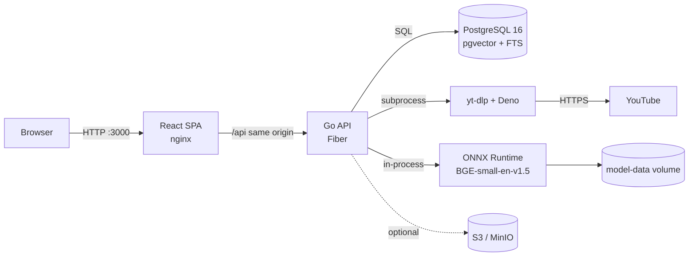
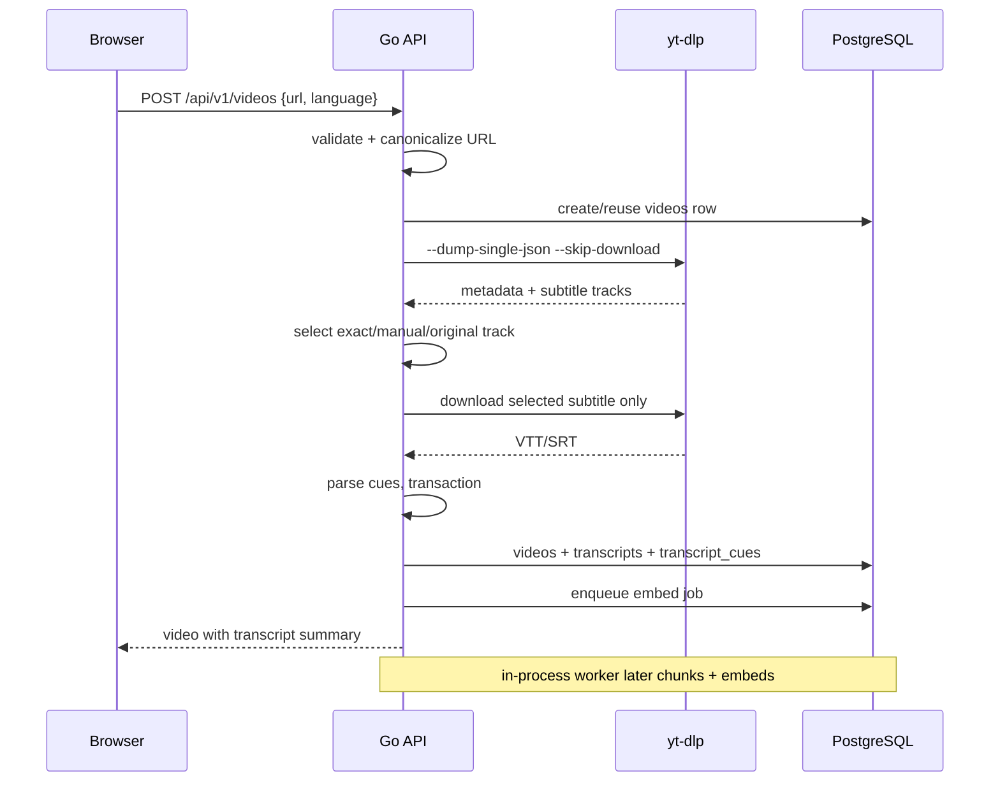
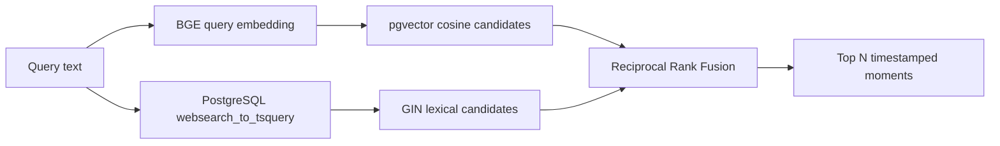

# Architecture

Sutra is a self-hosted semantic search engine for video transcripts. It turns
YouTube captions or uploaded VTT/SRT files into timestamped chunks, embeds
those chunks locally, and answers natural-language queries using hybrid
semantic + lexical retrieval.

The system is intentionally small: one Go binary that serves HTTP and runs its
own workers, one static frontend, one PostgreSQL database with pgvector, and an
optional S3-compatible artifact store. There is no Redis, Kafka, RabbitMQ,
separate worker service, or external AI API.

## Deployment topology



Docker Compose runs:

| Service | Responsibility |
|---|---|
| `db` | PostgreSQL 16 with the pgvector extension. Not published to the host by default. |
| `model-init` | One-shot downloader/verifier for the pinned BGE model and tokenizer. |
| `api` | Go HTTP API plus in-process PostgreSQL-backed job workers. |
| `frontend` | Static Vite build served by nginx; proxies `/api` to `api`. |
| `minio` | Optional profile only; artifact storage is not required for the app. |

Startup order is enforced by Compose conditions:

```text
db healthy ──┐
             ├──> api healthy ──> frontend healthy
model-init ──┘  (completed)
```

The API binary applies embedded migrations and loads/warm-ups the ONNX model
before it starts listening. The model initializer must finish successfully
first, so the API never discovers a half-downloaded model.

## Backend packages

The Go module is currently named `github.com/berzz/searcher/backend` for
historical import compatibility. Source lives in `api/`.

| Package | Responsibility |
|---|---|
| `cmd/server` | Process entry point, embedded migrations, graceful shutdown. |
| `internal/server` | Fiber application assembly and signal handling. |
| `internal/api` | HTTP routes, handlers, response/error mapping. |
| `internal/config` | Environment-variable loading and validation. |
| `internal/domain` | Plain business structs (videos, cues, chunks, jobs). |
| `internal/ingestion` | YouTube URL validation, yt-dlp extraction, subtitle discovery, upload ingestion. |
| `internal/transcript` | VTT/SRT parsing and normalization. |
| `internal/processing` | Deterministic cue-to-chunk grouping and embedding orchestration. |
| `internal/embedding` | Resident BGE-small-en-v1.5 ONNX session, tokenization, pooling, normalization. |
| `internal/jobs` | In-process workers that claim `embed` jobs from PostgreSQL. |
| `internal/persistence` | pgx pool, migration runner, queries and transactions. |
| `internal/retrieval` | Query embedding, vector/lexical candidates, Reciprocal Rank Fusion. |
| `internal/rerank` | Reserved package for future reranking; not implemented. |
| `internal/artifact` | Optional S3-compatible transcript artifact storage. |

Dependency wiring is explicit in `api/cmd/server/main.go`. There is no global
service locator or dependency-injection framework.

## Request flows

### YouTube ingestion



Only the selected subtitle file is downloaded. Audio and video media are never
fetched. A video with no usable caption track returns `NO_TRANSCRIPT`; an
explicitly requested language that is unavailable returns
`LANGUAGE_UNAVAILABLE`.

Subtitle selection preserves yt-dlp's exact language keys:

- Manual tracks are preferred over automatic captions.
- An explicit request never silently falls back to another language.
- Original automatic tracks (for example `en-orig`) beat translated generic
  automatic tracks.
- Exact regional requests such as `en-US` stay more specific than `en-orig`.
- The remaining matches are sorted deterministically.

`GET /api/v1/videos/subtitles` exposes the compatible tracks for a URL so a UI
can let the user choose an exact `subtitle_key` and `subtitle_source`.

### Upload ingestion

The multipart upload is read with a byte limit, parsed as VTT or SRT, and
content-sniffed so the declared extension must match the bytes. The SHA-256 of
the file is the deduplication key (`videos.source_ref` for uploads). A repeated
identical upload returns the existing video rather than creating a duplicate.
Video metadata, the transcript summary, and all cues are committed in one
transaction. The original subtitle is stored as an artifact only when artifact
storage is enabled.

### Processing

An ingestion transaction creates one `embed` job for the video. In-process
workers claim queued jobs with:

```sql
SELECT ... FROM jobs
WHERE kind = 'embed' AND status = 'queued' AND run_after <= now()
ORDER BY created_at
FOR UPDATE SKIP LOCKED
LIMIT 1
```

The worker:

1. Loads raw cues ordered by `seq`.
2. Groups complete cues into chunks around a 180-word target (80-word minimum,
   250-word maximum) with up to 30 words of complete-cue overlap.
3. Produces deterministic chunk IDs and a unique `(video_id, seq)` sequence.
4. Tokenizes and embeds chunks in batches through ONNX Runtime.
5. Mean-pools the token vectors using the attention mask and L2-normalizes
   the result to 384 dimensions.
6. Upserts chunks and vectors in one transaction.

Failures are retried up to five attempts with exponential backoff. Because
`(video_id, seq)` is unique and upserts replace chunk rows, retries are safe.
`go run ./cmd/backfill` enqueues videos that have cues but no chunks and uses
the same worker pipeline.

### Search



Both candidate lists are retrieved independently, each with a configurable
pool size (default 100). They are merged by chunk ID using Reciprocal Rank
Fusion:

```text
score = sum(1 / (k + rank))    k = 60 by default
```

The returned `score` is an RRF score, not a probability. `semantic_score` is
cosine similarity (`1 - pgvector cosine distance`); `lexical_score` is
PostgreSQL `ts_rank_cd` when the lexical method returned that chunk. Results
carry video titles, original URLs, and (for YouTube) a `timestamp_url` that
preserves the original query parameters and adds `t=<seconds>`.

The API does not rerank results or generate summaries. The `internal/rerank`
package is reserved for a possible future phase.

## Why this retrieval design?

A bi-encoder embeds the query and each transcript chunk independently, then
compares vectors. That makes indexing a one-time cost per chunk and search a
single vector query, which fits a self-hosted single-node deployment. The
trade-off is that a bi-encoder is less precise than a cross-encoder reranker;
Sutra does not pretend otherwise.

Lexical search complements embeddings: exact names, numbers, product names, and
unusual terms that a small English embedding model may blur are still found by
PostgreSQL full-text search. RRF combines rankings without needing to calibrate
two different score scales.

## Database shape

| Table | Purpose |
|---|---|
| `videos` | One row per YouTube video or uploaded transcript. |
| `transcripts` | One summary row per video: extraction method, language, format, optional artifact key, cue count. |
| `transcript_cues` | Raw timestamped cues from extraction/upload. Source of truth. |
| `transcript_chunks` | Derived search chunks, 384-d embeddings, generated `tsvector`. |
| `video_processing` | Per-video processing status/progress and model version. |
| `jobs` | PostgreSQL-backed asynchronous queue. |
| `schema_migrations` | Applied migration filenames. |

Raw cues and derived chunks are deliberately separate. A cue is an exact
extraction artifact; a chunk may span several cues and is tuned for retrieval.
See [database.md](database.md) for the full schema and migration rules.

## Configuration philosophy

All runtime configuration is environment variables. Defaults are usable for a
local Compose install; remote deployments must set their own database and
object-store credentials. There are no hidden configuration files inside the
application. See [configuration.md](configuration.md).

## Explicit non-goals / current limits

- No reranking, answer generation, summarization, or multimodal search.
- No GPU acceleration; the default image uses the CPU ONNX Runtime.
- No authentication or multi-user permission model. Put an authenticating
  reverse proxy in front of a shared deployment.
- No distributed workers, external queue, or horizontal job coordination.
- Linux amd64 containers are the verified target. ARM64 is not currently
  supported end-to-end because the ONNX Runtime and yt-dlp/Deno artifacts are
  pinned for x86_64.
- YouTube extraction depends on yt-dlp and YouTube's current behavior; it can
  break when YouTube changes its player or challenge system.
